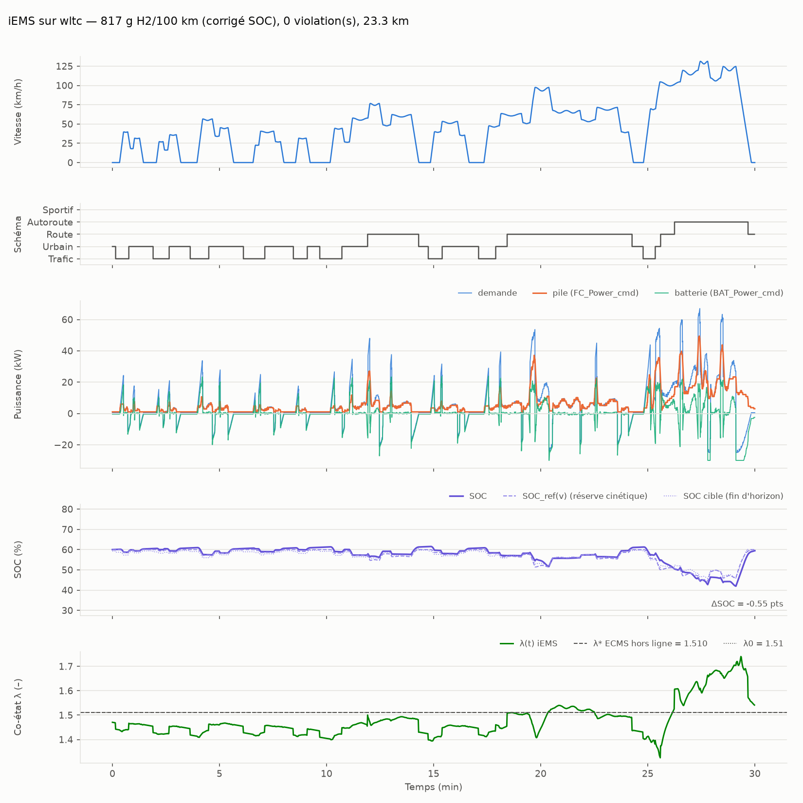

# iems-py — gestion d'énergie temps réel d'un véhicule hybride hydrogène

Portage Python, en réécriture *clean-room*, de l'**iEMS** (integrated Energy Management
Strategy) issu de ma thèse : un pilotage temps réel du partage de puissance entre pile à
combustible et batterie qui combine

- **optimisation** : principe du minimum de Pontryaguin en ligne, sur horizon glissant, avec
  co-état adaptatif ;
- **règles** : pourcentage d'utilisation de la batterie et SOC cible fonction du schéma de
  conduite, de la vitesse et de l'état de charge ;
- **reconnaissance de conduite** : classification en ligne du schéma (trafic, urbain, route,
  autoroute, sportif) et prédiction de la vitesse sur l'horizon.

Le simulateur compare l'iEMS à deux références sur WLTC et sur des cycles synthétiques
étiquetés : un *power follower* à règles et un ECMS à co-état constant calibré hors ligne.



## Démarrage en trois commandes

```bash
python -m venv .venv && .venv/Scripts/pip install -e ".[dev]"     # Linux/mac : .venv/bin/pip
python examples/compare_strategies.py                                # tableau + figures (examples/output)
python examples/m1_report.py                                         # rapport de conformité M1 (docs/)
```

Python ≥ 3.11 ; dépendances : numpy, scipy, pydantic, matplotlib. Aucune dépendance MATLAB,
aucun appel réseau. Un WLTC de 1 800 s se simule en ≈ 0,5 s.

```python
from iems.simulator import run
from iems.metrics import compute_metrics

res = run("wltc", "iems")               # ou "rules_baseline", "ecms_const"
print(compute_metrics(res).row())        # conso g/100 km, ΔSOC, violations, bilan d'énergie
```

## Résultats (jalon M1, configuration par défaut)

| Cycle | Règles (g/100 km) | ECMS λ constant* | iEMS | ΔSOC iEMS | Violations |
|---|---|---|---|---|---|
| WLTC classe 3b | 821,6 | 803,8 | **817,0** | −0,5 pt | 0 |
| Synthétique mixte | 832,3 | 824,2 | **823,9** | +1,2 | 0 |
| Urbain dense | 969,8 | 982,7 | **956,3** | +2,6 | 0 |
| Route + autoroute | 936,4 | 922,5 | **928,2** | −1,1 | 0 |
| Sportif | 890,9 | 883,1 | **880,8** | +0,1 | 0 |

Consommations d'hydrogène corrigées du SOC final. \*L'ECMS à λ constant est calibré par
dichotomie **avec une prédiction exacte** du cycle : c'est la référence quasi-optimale hors
ligne. Les règles et l'iEMS tournent avec un prédicteur bruité. Les six critères
d'acceptation M1 sont vérifiés par `examples/m1_report.py` : [docs/m1_report.md](docs/m1_report.md).

Ce que la figure montre (soutenance) : le co-état en ligne oscille autour du co-état optimal
hors ligne ; les hautes fréquences de la demande vont à la batterie, les basses à la pile ;
le SOC suit une référence abaissée avec la vitesse (réserve pour la récupération au freinage),
ce qui ramène le WLTC à ± 1 point de SOC sans connaître la fin du cycle. Adaptation au SOC
initial (résultat de thèse reproduit) : parti de 35 % ou de 75 %, l'iEMS termine le WLTC au
même SOC (≈ 60 %), à 0 violation (table de sensibilité du rapport).

## Architecture

```
src/iems/
├── config.py          # pydantic : VehicleParams, FuelCellParams, BatteryParams, EMSParams
├── models/            # vehicle (P_dem longitudinal), battery v1, fuel_cell, cycles (WLTC + synthétique)
├── dpt/               # predictor (oracle bruité, v2 : LSTM) ; dpr (règles à seuils, v2 : fuzzy c-means)
├── candidates.py      # bornes PàC/batterie, anticipation sur l'horizon, 9 candidats + vecteur de secours
├── balance.py         # usage batterie f(v, SOC, schéma) → SOC cible → co-état λ
├── optimizer.py       # Hamiltonien H = ṁ_H2 − λ·k_h·dSOC/dt, pénalités (passe-plat v1), argmin
├── strategies.py      # rules_baseline, ecms_const (+ calibration), iems — même interface step()
├── simulator.py       # pas fixe, deux cadences (modèle 0,1 s / EMS 1 s), bilan de bus vérifié
└── metrics.py         # conso brute et corrigée du SOC, violations, bilan d'énergie
```

À chaque pas EMS : DPT (schéma + vitesse prédite) → Candidates (bornes utilisables, 9
consignes PàC) → Balance (usage, SOC cible, λ) → Optimizer (argmin du Hamiltonien) →
`FC_Power_cmd`, `BAT_Power_cmd`, appliquées au pas modèle par le simulateur.

### Choix de modélisation à connaître

- **Pile** : consommation convexe `a + b·P + c·P²` ajustée sur la carte de rendement en
  cloche de la config (η ≈ 0,40 → 0,58 → 0,45). Une interpolation linéaire de η rend le
  Hamiltonien non convexe et la calibration de λ mal posée.
- **Prédicteur v1** : oracle bruité dont l'erreur est d'ordre 2 en τ (vitesse *et*
  accélération courantes mesurées) ; à 110 km/h, 1 km/h d'erreur sur la vitesse à 1 s vaut
  15 kW de demande, d'où une **marge inertielle** `m·v·σ_a/η` dans l'admissibilité.
- **Charge-sustaining** : SOC de référence `soc_ref − k·½·m·v²/E_cap` (réserve cinétique,
  ≈ 0,8 mesuré sur le freinage final du WLTC) + adaptation proportionnelle du co-état.
- **WLTC** : reconstruction structurelle (durées, distances et vitesses max des 4 phases
  conformes au GTR 15), pas la table officielle point à point ; déposer celle-ci dans
  `src/iems/data/wltc_class3.csv` la remplace sans autre changement.
- Les paramètres chiffrés sont génériques (classe berline) et marqués `# TODO-thèse`.

## Qualité

```bash
.venv/Scripts/python -m pytest -q          # 358 tests, ≈ 40 s
.venv/Scripts/ruff check src tests examples
```

Les tests couvrent la conservation d'énergie (bilan de bus à chaque pas), les bornes et la
dégénérescence des candidats, la monotonie des limites batterie, le charge-sustaining, les
critères M1, le déterminisme (graine fixée pour l'oracle et le générateur de cycles) et la
performance. Sous Windows, lancer Python avec `PYTHONUTF8=1` si la console est en cp1252.

## Feuille de route

| Jalon | Contenu | État |
|---|---|---|
| M1 | Simulateur, 3 stratégies, métriques, figures | ✅ |
| M2 | API FastAPI (`/simulate`, `/compare`, `/strategies`, `/cycles`) + Docker | à venir |
| M3 | Outils agent (function calling / MCP) : `run_simulation`, `compare_strategies`, `explain_result` | à venir |
| M4 | Ingestion CSV flotte + dashboard Streamlit | à venir |
| v2 | LSTM (torch) et logique floue (scikit-fuzzy) à iso-interface | optionnel |

## Licence

MIT. Travail personnel : aucun fichier, modèle ou donnée d'un projet industriel n'est
réutilisé ; les principes viennent de la thèse publique et de la littérature.
